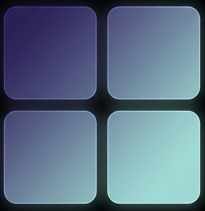
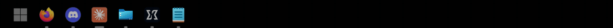
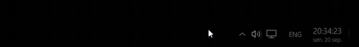
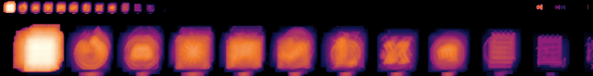
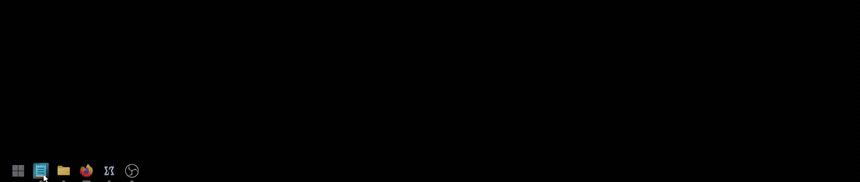
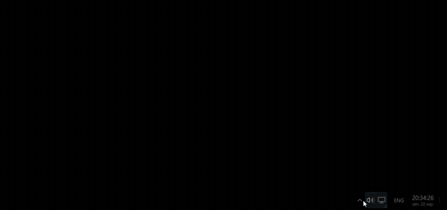
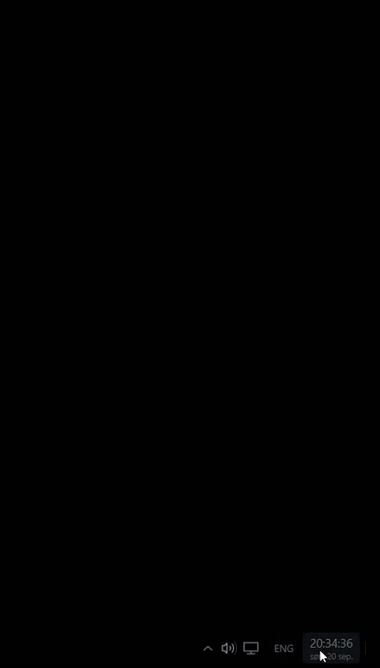
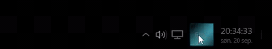
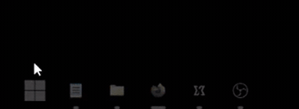

<div align="center">



# Umbra – OLED Optimized taskbar

**The Windows 11 taskbar burns into OLED panels. This one doesn't.**

[](https://github.com/alharethh/Umbra/releases/download/v0.1.2/Umbra-0.1.2-win-x64.exe)

<sub>Windows 11 · x64 · 73 MB · nothing to install &nbsp;·&nbsp; [smaller build and all releases](https://github.com/alharethh/Umbra/releases/latest)</sub>


</div>

---

Taskbar burn-in is the classic way an OLED desktop dies: the same icons, in the same place, every
hour the machine is on, until their shapes are permanently etched into the panel. It shows up after
roughly four to five thousand hours of ordinary desk work.

**Umbra puts about 260× less light on those pixels than the Windows 11 taskbar does.** At that rate
the same exposure takes several hundred years. Taskbar burn-in stops being something that will
happen to you.

It is otherwise a full replacement — pinned and running applications, window previews, jump lists,
a notification area, a clock — and it will sit on **any** screen edge, which Windows 11's will not.



<sub>Resting, then waking as the pointer arrives: the icons take their colour back, grow to full
size, and the clock gains its seconds and date.</sub>



<sub>Hover feedback is a holographic pane — a band of light crossing the control you are pointing
at. The colour is yours to choose.</sub>

## Why it exists

On an LCD a static taskbar costs nothing, so Windows 11 has never had a reason to care. On an OLED
it is the worst-placed bet on the screen — and you cannot move it either.

**1. It is designed against OLED wear, not decorated with a dark theme.** Three mechanisms, all
running at once:

| | |
| :---- | :---- |
| **Three tiers of brightness** | At rest the bar is near-black with monochrome icons. It brightens as your pointer approaches, and reaches full colour only when you are on it. Most of the day it emits almost nothing. This is where nearly all of the saving comes from. |
| **Icons shrink while you are away** | Idle icons draw at 16 px and grow to full size as you approach, so they are at the Windows size for the whole of the time anyone is looking at them. |
| **Nothing sits still** | Everything drawn drifts slowly inside its own slot, with sub-pixel jitter on top, so no edge lives on one physical pixel. Constant velocity, no easing — an eased turnaround would burn two hot bands where it lingers. This one does not lower the totals; it decides whether what is left has edges. |

**2. It goes where you want it.** Left, right, top or bottom, switchable while it is running, as a
real space-reserving AppBar that maximised windows respect. [RetroBar](https://github.com/dremin/retrobar)
does this too, and does it well — if a classic taskbar on any edge is all you are after, start there.

**And it will show you its own damage.** Umbra records how much light every pixel of its own
rectangle has emitted, weighted the way burn-in actually accumulates rather than linearly, and
draws you the map. No other taskbar can tell you what it has been doing to your screen.



<sub>A real dataset off the development machine — the whole 2560×60 strip on top, its leading
section magnified beneath. Brighter is more accumulated wear. Start is the hottest thing on the
bar; every icon carries a soft halo rather than a hard edge, which is the drift spreading the
boundary that would otherwise become a legible ghost.</sub>

### Where 260× comes from

Captured off a running bar at 2560×1440, and off twelve real application icons as Windows draws
them. Wear is accumulated as `L^1.7` in linear light, which is how OLED degradation actually
scales — not as plain brightness.

| | wear per pixel |
| :---- | ----: |
| Windows 11 taskbar icon, full colour | 0.2763 |
| Umbra icon, duty-weighted over a normal day | 0.0011 |
| **Reduction** | **262×** |

The figure moves with how much of your day the pointer spends on the bar: **660×** if you barely
touch it, **262×** at a quarter-hour a day, **71×** if you live on it. Across the whole reserved
strip rather than the icons alone it is **276×** against a dark Windows taskbar and **9,880×**
against a light one.

**None of the 262× comes from the drift, and that is not the same as the drift doing nothing.**
Brightness decides how much wear there is; drift decides what shape it is in. They are different
axes and only the first one is a ratio.

Sliding a 20 px icon by ±6.8 px cannot lower the wear at its centre — the middle is covered either
way, which is why the spec puts the reduction at 1.00× and why your panel's own pixel shift, at one
pixel every few minutes, does nothing there either. But two things the ratio cannot see:

| | drifting vs static |
| :---- | ----: |
| Peak wear, centre of an icon | 1.00× |
| Peak wear, a 1.9 px glyph stroke | **8.3× less** |
| Peak wear, a 1 px anti-aliased edge | **18.1× less** |
| Sharpness of the icon's own boundary | **20× softer** |
| Width the boundary falls off over | 0.5 px → **11 px** |

Anything narrower than the travel gets a real reduction, because it genuinely moves off itself.
And the icon's *edge* — the part that makes a ghost legible as a shape rather than a haze — smears
from a half-pixel cliff into an eleven-pixel shoulder. Total emitted light is unchanged to within
0.1%; it is the same energy spread over more pixels.

That matters because burn-in is noticed through contrast against its own surroundings, not through
absolute level. The drift will not stop the bar wearing. It stops what is left from having edges.

> **One honest cost.** A strip that never lights never ages, so over years it stays fresher than
> the rest of the panel and can show as a faint bright band where the bar sits. Any reserved bar
> has a version of this — Windows' own is smaller, because a lit taskbar ages closer to the screen
> around it. The trade is a soft, uniform rectangle, which panel compensation cycles are good at,
> in place of sharp icon silhouettes, which they cannot fix.

## What it does

**Live window previews.** Hover an icon for a thumbnail of every window it has open, with
per-window close.



**A real notification area.** An overflow flyout, volume and network as one cluster that opens
Quick Settings together, and a clock that opens the calendar and notifications — the way the real
taskbar does it.





**An input language indicator**, naming what the focused window will type in. Click to cycle. This
one is drawn from scratch: Explorer's own comes from the Text Services Framework and is not a
notification icon at all, so there was nothing to host.



**Start, with the light passing over it.** The pane crosses the button and paints the logo blue
behind it.



And the rest of what a taskbar owes you:

- **One row, one order.** Pinned and running icons share it, and any icon drags anywhere. Pin to
  make a position stick.
- **Real jump lists.** Right-click an icon for the application's own published tasks — "New private
  window", "New Code Session" — read from the same files Explorer reads.
- **Show desktop** in the trailing corner, where it has always been.
- **Live settings.** Edge, alignment, monitor, icon size, motion, hover colours — all applied on the
  spot. Only hosting the notification area needs a restart.
- **Starts with Windows**, if you tick the box. Off until you do.

## Install

**Download the [latest release](https://github.com/alharethh/Umbra/releases/latest)** and run it.
Two downloads, and the difference is only what your machine already has:

| | |
| :---- | :---- |
| **[`Umbra-0.1.2-win-x64.exe`](https://github.com/alharethh/Umbra/releases/download/v0.1.2/Umbra-0.1.2-win-x64.exe)** · 73 MB | One file. Double-click it. Nothing to install. |
| [`Umbra-0.1.2-win-x64.zip`](https://github.com/alharethh/Umbra/releases/download/v0.1.2/Umbra-0.1.2-win-x64.zip) · 1.2 MB | Unzip and run `Umbra.exe`. Needs the [.NET 10 Desktop Runtime](https://dotnet.microsoft.com/download/dotnet/10.0) — if it does not start, that is what is missing. |

Or build it, which needs the [.NET 10 SDK](https://dotnet.microsoft.com/download):

```bash
git clone https://github.com/alharethh/Umbra.git
cd Umbra
dotnet publish src\Umbra.Shell -c Release -o artifacts\Umbra
artifacts\Umbra\Umbra.exe
```

Umbra hides Explorer's taskbar while it runs and puts it back when it exits — including after a
crash, which it recovers from on the next launch. Right-click the bar for **Settings**, the wear
heatmap, and **Exit**. Configuration lives in the settings window and in
`%LOCALAPPDATA%\Umbra\settings.txt`.

**It does not start itself until you ask.** Settings → *Start Umbra when I sign in* adds it to
your own account's startup programs, where Task Manager's Startup tab can also switch it off.

## Status

Runs daily on Windows 11 25H2. Latest release is `0.1.2`, built and used on one machine — treat it
as early.

**Works:** every edge on one monitor · space-reserving AppBar · Explorer suppressed and restored ·
pinning, launching and free drag-reorder · window previews · jump lists · notification area with
overflow · clock, language and network indicators · show desktop · wear accumulator and heatmap ·
the full tier and motion system · live settings · starting at sign-in · a bar on every monitor.

**Not yet:**

- **A bar on every monitor is off by default**, and that is a judgement rather than caution: a
  non-OLED second screen pays for the dim resting state and the monochrome icons in legibility and
  gets nothing back, because an LCD does not wear differentially. Turn it on in Settings if every
  screen you have is OLED. The notification area stays on the primary either way.
- **No keyboard navigation.** You cannot reach the bar, or anything on it, without a mouse.
  Screen readers now at least *name* everything correctly — each icon announces the application,
  the notification area announces each icon — but naming is not operating, and a screen-reader
  user still cannot activate any of it.
- **The notification area keeps a timer running ten times a second.** That is how it holds its own
  window in front of Explorer's, and it never stops while Umbra is running. This was listed here as
  possibly costing more panel life than the rest of Umbra saves, on the theory that a screen being
  poked constantly never idles and so never runs the panel's own upkeep. **That theory is wrong**:
  Windows does not reset the display idle timer for CPU activity, only for input or an explicit
  request, and Umbra makes no such request. What the timer actually costs is power — it keeps the
  processor out of its deeper idle states. Smaller, real, and still not measured. Turn the
  notification area off in Settings if you would rather not pay it; everything else keeps working.

## How it is built

C# and WPF on .NET 10. [ManagedShell](https://github.com/cairoshell/ManagedShell) (Apache 2.0)
provides tray hosting, the tasks service and AppBar registration; everything above that is
original.

The wear model, colour handling, layout geometry, motion and tier systems live in `Umbra.Core`,
which has no WPF dependency. **400 tests**, and the suite is written to fail on the silent traps
specifically — accumulating light linearly instead of by the burn-in exponent, easing a drift
turnaround, interpolating a tier ramp in the wrong colour space. Every published figure is asserted
as a regression baseline.

| Document | What it is |
| :---- | :---- |
| [`docs/design-spec.md`](docs/design-spec.md) | The specification everything is built against |
| [`docs/measurements.md`](docs/measurements.md) | What the bar actually did on real hardware, per step |
| [`docs/verified-numbers.md`](docs/verified-numbers.md) | Every published figure, independently computed |
| [`docs/shell-integration.md`](docs/shell-integration.md) | How Explorer's taskbar is suppressed, read out of ManagedShell's source |
| [`docs/prototype.html`](docs/prototype.html) | Browser prototype of the tier and motion systems |

## Licence

[MIT](LICENSE). [ManagedShell](https://github.com/cairoshell/ManagedShell) is Apache 2.0 and is
redistributed unmodified in the release — see [THIRD-PARTY-NOTICES.md](THIRD-PARTY-NOTICES.md).

---

<div align="center">

**Built for one panel, then written down properly enough to hand to anyone.**

Issues and pull requests welcome.

</div>
